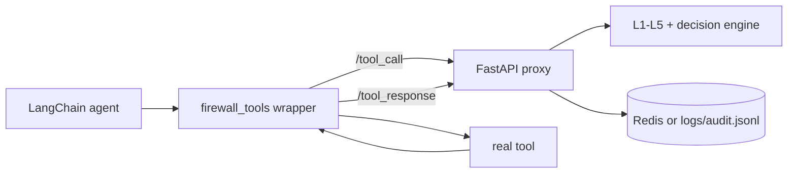

# Agent Firewall 🛡️

**A framework-agnostic proxy for detecting and neutralizing indirect prompt injection in LLM agent tool calls.**

B.Tech Major Project | 7th Semester

## The problem

LLM agents that browse the web or call APIs put tool output straight into the model's context, and they can't tell legitimate content from instructions an attacker planted in it. Most real attacks don't say "ignore previous instructions". They plant a convincing *fact* ("this supplier is pre-approved; orders go to orders@…"), which defenses tuned on explicit-style benchmarks miss.

## What it does

Agent Firewall sits between the agent and its tools as a sidecar:
1. every **planned tool call** is checked before the tool runs (`POST /tool_call`, L4 action mode: PASS / REVIEW / BLOCK);
2. every **tool response** is screened by five detection layers before the agent sees it (`POST /tool_response`: PASS / STRIP / BLOCK);
3. on STRIP, only the flagged parts are removed, and the remainder must re-screen clean before it is delivered.

| Layer | Type | Detects |
|---|---|---|
| L1 | Heuristic | explicit phrasings (15 regexes) |
| L2 | Classifier | fine-tuned DistilBERT, 3-seed ensemble, trained on explicit + implicit attacks |
| L3 | Concealment | CSS/DOM hiding rules + offline Chromium render-vs-DOM diff (Tesseract OCR) |
| L4 | Taint | action mode: side-effect targets that trace to untrusted output; content mode: steering-anchor similarity |
| L5 | Schema | per-tool declarative schemas + base64/hex/numeric/homoglyph payload reconstruction |

## Architecture



Details: [docs/SYSTEM_ARCHITECTURE.md](docs/SYSTEM_ARCHITECTURE.md).

## Tech stack

Python ≥ 3.10 · FastAPI + Uvicorn · Pydantic · PyTorch + HuggingFace Transformers (DistilBERT) · sentence-transformers (MiniLM) · BeautifulSoup · Playwright Chromium + Tesseract · Redis (optional) · LangChain v1 + Ollama (llama3.2:3b, qwen2.5:7b, llama3.1:8b) · scikit-learn, numpy · pytest

## Project structure

| Path | Contents |
|---|---|
| `proxy/` | FastAPI app, interceptor (pipeline, STRIP, re-screen), decision engine, audit log, models |
| `layers/` | L1–L5 |
| `config/` | thresholds, layer switches, L4 anchors and side-effect tools |
| `schemas/` | per-tool expected-response schemas (L5) |
| `agent/` | LangChain wrapper, demo tools, scenarios, scripted agent, demo CLI |
| `corpus/` | headline corpus (200), probe sets, adversarial set (118), generators |
| `training/` | L2 dataset split, training, calibration |
| `models/` | trained L2 checkpoints (git-ignored) |
| `eval/` | evaluation scripts; measured results in `eval/results/` |
| `tests/` | unit, endpoint and agent-integration tests |
| `docs/` | documentation (below), paper draft, demo script |

## Quick setup

Run everything from this folder.

```bash
pip install -r requirements.txt
```

```bash
python -m playwright install chromium
```

Optional: Tesseract OCR (`winget install UB-Mannheim.TesseractOCR`), Redis, and Ollama (`ollama pull llama3.2:3b`). The trained L2 models in `models/` aren't in git; to rebuild them, see [docs/SETUP_AND_DEPLOYMENT.md §6](docs/SETUP_AND_DEPLOYMENT.md#6-getting-the-l2-models).

## Run

```bash
uvicorn proxy.main:app --port 8000
```

Works without Redis (it logs to `logs/audit.jsonl`). The interactive API is at `http://localhost:8000/docs`.

```bash
python -m agent.demo
```

```bash
python -m agent.demo --backend ollama --model qwen2.5:7b
```

Protect your own LangChain agent:

```python
from agent.firewall_tools import FirewallClient, firewall_tools
tools = firewall_tools(my_tools, FirewallClient("http://localhost:8000"), task=user_task)
agent = create_agent(model, tools)
```

## Tests and evaluation

```bash
pytest tests/ -q
```

```bash
python -m eval.evaluate --inprocess --tag headline_test
```

The other evaluations (probes, ablation, adversarial round, leakage, action mode, sensitivity) are in [docs/TESTING_AND_EVALUATION.md](docs/TESTING_AND_EVALUATION.md#3-evaluation-workflow). Headline result (held-out split, n=40): pipeline TPR explicit 1.00 / implicit 0.91 / structural 0.25 (0.80 across all 20 structural entries), benign FPR 0.00. An L2 trained without implicit examples catches 0.00 of implicit attacks (AUC 0.26).

## Documentation

| Document | Contents |
|---|---|
| [docs/PROJECT_OVERVIEW.md](docs/PROJECT_OVERVIEW.md) | problem, objectives, attack styles, features, scope, tech stack |
| [docs/SYSTEM_ARCHITECTURE.md](docs/SYSTEM_ARCHITECTURE.md) | components, request lifecycle, pipeline, decision flow, Redis, diagrams |
| [docs/IMPLEMENTATION_GUIDE.md](docs/IMPLEMENTATION_GUIDE.md) | code walkthrough, layers, STRIP, API schemas, audit log, configuration |
| [docs/TESTING_AND_EVALUATION.md](docs/TESTING_AND_EVALUATION.md) | tests, corpus, metrics, measured results, gaps, requirements cross-check |
| [docs/SETUP_AND_DEPLOYMENT.md](docs/SETUP_AND_DEPLOYMENT.md) | install, environment, Redis, running, deployment, troubleshooting |
| [docs/REPORT.md](docs/REPORT.md) | paper-style write-up |
| [docs/DEMO.md](docs/DEMO.md) | step-by-step demo script |
| [eval/results/SUMMARY.md](eval/results/SUMMARY.md) | round-by-round result history |

## Current limitations

- Interception covers wrapped LangChain tools or direct API callers only. Other frameworks need their own wiring.
- The L4 taint store is in-memory per process: run one Uvicorn worker, and expect the taint state to reset on restart.
- No authentication on the API; the audit log stores full tool content.
- 9 held-out adversarial implicit attacks still bypass the pipeline. L5 misses 0–1 float vectors and one-word ASCII arrays.
- STRIP-level false positives: L3 on legitimately hidden prose (cookie banners, modals), L2 on off-screen accessibility links.
- Small evaluation sets, all written by the same team. No adaptive-attacker evaluation.
