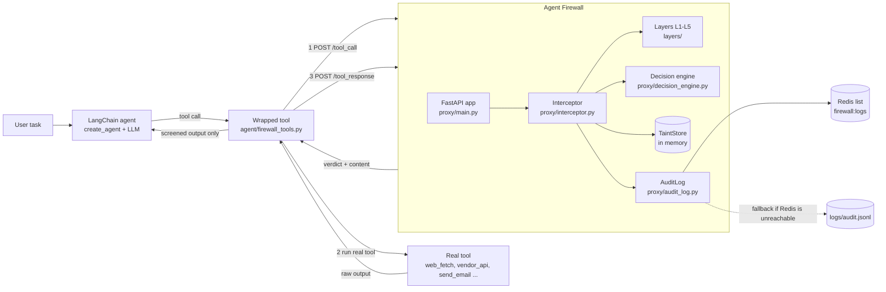
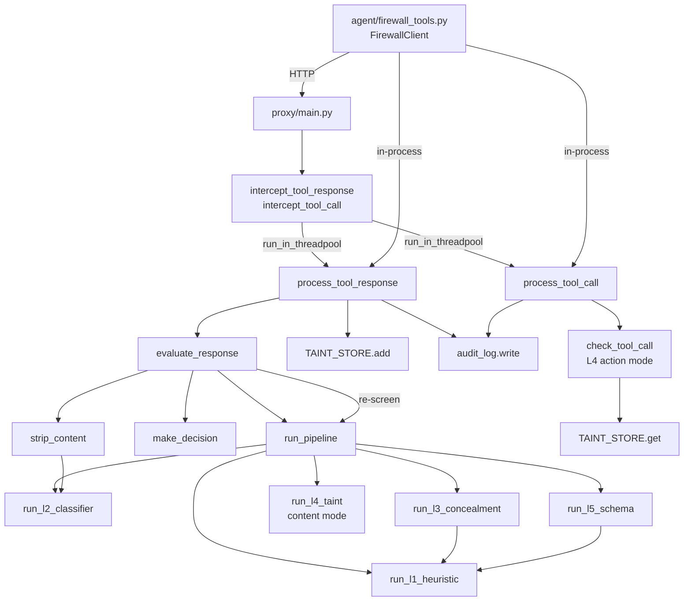
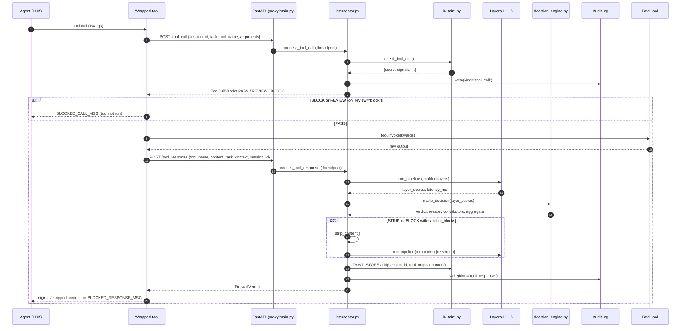
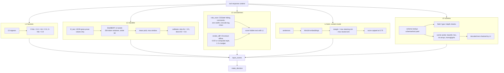
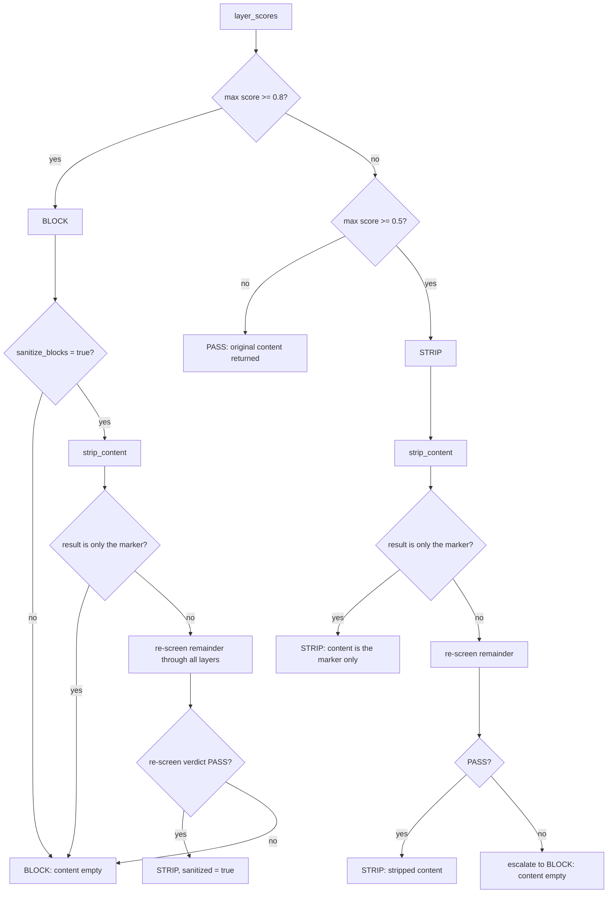
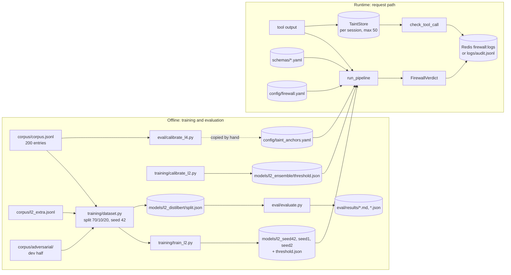

# System Architecture

This document describes how Agent Firewall's components fit together and how a request moves through them. Every diagram follows the code as it is. File and function names are given so you can check them. For a code-level walkthrough, see [IMPLEMENTATION_GUIDE.md](IMPLEMENTATION_GUIDE.md).

---

## 1. High-level architecture

Agent Firewall is a **sidecar**: the agent framework isn't modified. Instead, each tool the agent uses is replaced by a wrapped copy with the same name and schema. The wrapper asks the firewall about the planned call, runs the real tool, and then asks the firewall to screen the output.

The firewall can be reached in two ways, and both run the same code:
- **HTTP**: a FastAPI service (`proxy/main.py`) started with Uvicorn;
- **in-process**: `FirewallClient()` with no URL calls `proxy.interceptor` functions directly. The tests, the demo and the evaluations use this mode.

## 2. Component-level architecture

| Component | File(s) | Responsibility | Depends on |
|---|---|---|---|
| Settings | `settings.py` | Path constants (`ROOT`, `CORPUS_PATH`, `MODELS_DIR`, `SCHEMAS_DIR`, `CONFIG_DIR`, `LOGS_DIR`, `RESULTS_DIR`), YAML loading, `firewall_config()` | PyYAML, `config/firewall.yaml` |
| API layer | `proxy/main.py` | FastAPI app, 4 routes, startup warm-up, creates the `AuditLog` | interceptor, models, audit log, L2/L3/L4 (warm-up) |
| Models | `proxy/models.py` | Pydantic schemas: `ToolResponseRequest`, `FirewallVerdict`, `ToolCallRequest`, `ToolCallVerdict` | Pydantic |
| Interceptor | `proxy/interceptor.py` | Runs the layer pipeline, applies the verdict, strips content, re-screens, tags taint, writes the audit log | all layers, decision engine |
| Decision engine | `proxy/decision_engine.py` | Turns layer scores into PASS / STRIP / BLOCK plus audit fields | `config/firewall.yaml` |
| L1 heuristic | `layers/l1_heuristic.py` | Regex matching of explicit phrasings | — |
| L2 classifier | `layers/l2_classifier.py` | DistilBERT ensemble inference, calibrated scores | `models/l2_*`, torch, transformers |
| L3 concealment | `layers/l3_concealment.py` | Hidden-text rules + render-diff in headless Chromium (OCR) | L1, BeautifulSoup, Playwright, Tesseract (optional) |
| L4 taint | `layers/l4_taint.py` | Content-mode anchor similarity; action-mode argument provenance; `TaintStore` | sentence-transformers, `config/taint_anchors.yaml` |
| L5 schema | `layers/l5_schema.py` | Schema checks + carrier decoding | L1, `schemas/*.yaml` |
| Audit log | `proxy/audit_log.py` | Redis LPUSH/LRANGE or JSONL append/read | redis-py |
| Agent integration | `agent/firewall_tools.py` | `FirewallClient` (HTTP or in-process), `firewall_tools()` wrapper | httpx, langchain-core, interceptor |
| Demo harness | `agent/run_agent.py`, `agent/demo.py`, `agent/scenarios.py`, `agent/demo_tools.py`, `agent/scripted_llm.py` | Scenarios, tools with a recording outbox, a scripted or Ollama agent | LangChain, langchain-ollama |
| Evaluation | `eval/*.py`, `training/*.py`, `corpus/*.py` | Offline only; never on the request path | interceptor (in-process) or HTTP |

### Component interaction

L3 and L5 both call L1 on text they uncover (hidden blocks, decoded payloads), so a hidden or encoded *instruction* scores higher than hidden or encoded *prose*.

## 3. Agent ↔ firewall ↔ tool communication

`agent/firewall_tools.py::firewall_tools(tools, client, task, session_id=None, on_review="block", events=None, screen_responses=True)` returns a `StructuredTool` per input tool. It reuses `name`, `description` and `args_schema`, so the LLM sees no difference. Every wrapper for one agent run shares the same `session_id`, which links tool responses (taint sources) to later tool calls.

What the agent gets back:

| Firewall result | What the wrapped tool returns to the agent |
|---|---|
| `/tool_call` BLOCK (or REVIEW with `on_review="block"`) | `BLOCKED_CALL_MSG`; the real tool **never runs** |
| `/tool_response` PASS | the original output |
| `/tool_response` STRIP | the stripped output (flagged parts replaced with `[removed by Agent Firewall]`) |
| `/tool_response` BLOCK | `BLOCKED_RESPONSE_MSG`, which tells the agent not to use this source |

With `screen_responses=False` (the demo's `calls_only` mode), the output is passed through unscreened but still tagged as untrusted through `FirewallClient.taint()`. That is in-process only; over HTTP it raises `NotImplementedError`.

## 4. Request-response lifecycle

Notes:
- The async endpoints hand the synchronous pipeline to a worker thread (`starlette.concurrency.run_in_threadpool`), so model inference doesn't block the event loop.
- The **original** content is added to the taint store, even when it was stripped or blocked. That way, a later call that uses a value from a blocked page is still traced to it.
- The taint store is only written when `session_id` is set on the `/tool_response` request.

## 5. Detection pipeline architecture

`run_pipeline(tool_name, content, task_context, layers=None, l2_variant=DEFAULT_VARIANT, render=True)` runs the layers listed in `config/firewall.yaml -> layers.enabled` **one after another** in the order L1→L5. It times each layer and returns `(layer_scores, latency_ms)`. Every layer returns a dict with at least `score` ∈ [0, 1] and `layer`, plus fields that locate what it flagged (`matched`, `spans`, `paths`).

Score levels per layer (constants in the code):

| Layer | Signal | Score |
|---|---|---|
| L1 | 1 pattern / ≥ 2 patterns | 0.5 / 0.9 |
| L2 | calibrated: raw prob at val `strip` threshold → 0.5, at `block` threshold → 0.8 (piecewise linear) | 0–1 |
| L3 | hidden text matching L1 / Unicode tag chars / ≥ 8 hidden words / ≥ 3 zero-width chars | 0.90 / ≥ 0.70 / 0.60 / 0.30 |
| L4 content | margin ≥ 0.224 maps to ≥ 0.5, capped at 0.79 (it can't BLOCK on its own) | 0–0.79 |
| L4 action | tainted target argument / strong drift / drift | 0.90 / 0.85 / 0.60 |
| L5 | decoded instruction / decoded text / mixed-script / schema violation / opaque blob / depth | 0.95 / 0.70 / 0.60 / 0.50 / 0.40 / 0.30 |

## 6. Decision engine flow

`make_decision(layer_scores)` uses an **any-layer-over-threshold** rule with `block_threshold: 0.8` and `strip_threshold: 0.5` (`config/firewall.yaml`). It also records `contributors` (layers ≥ 0.5, highest first) and an `aggregate` (weighted mean, weights all 1.0). The aggregate goes into the audit log only; **it does not affect the verdict**.

`evaluate_response` then applies the verdict:

The **tool-call** path (`process_tool_call`) has no STRIP. It maps the L4 action-mode score to `BLOCK` (≥ 0.8), `REVIEW` (≥ 0.5) or `PASS`.

## 7. Data flow

## 8. Redis and audit-logging architecture

- **What Redis stores:** only the audit log. `AuditLog.write()` does `LPUSH firewall:logs <json>`, and `AuditLog.recent(n)` does `LRANGE firewall:logs 0 n-1`, so entries come back newest first.
- **Connection:** `AuditLog(host, port)` with `socket_connect_timeout=1` and a `PING` at construction time. `proxy/main.py` takes `REDIS_HOST` / `REDIS_PORT` from the environment (defaults `localhost` / `6379`). The connection is decided **once at startup**. No password or DB index is configurable.
- **Fallback:** if the ping fails, entries are appended to `logs/audit.jsonl` under a thread lock. `recent()` reads the file's last *n* lines in reverse, so the order matches Redis. `GET /health` and `GET /logs` report which backend is active (`"redis"` or `"jsonl:<path>"`).
- **No retention:** the Redis list and the JSONL file grow without bound. There is no TTL, trimming or rotation.
- **Not in Redis:** the L4 `TaintStore` (an in-memory `defaultdict` of `deque(maxlen=50)` per session) and the loaded models.
- **In-process callers:** `FirewallClient()` creates its own `AuditLog()` with the default `localhost:6379`. `eval/evaluate.py --inprocess` calls `evaluate_response` directly and writes no audit entries. `NullAuditLog` exists for callers that want no logging.

The audit entry schema is in [IMPLEMENTATION_GUIDE.md §9](IMPLEMENTATION_GUIDE.md#9-redis-data-structures-and-audit-log-schema).

## 9. External integrations

| Integration | Used for | Needed at runtime? |
|---|---|---|
| Redis server | audit log | No (JSONL fallback) |
| HuggingFace Hub / local cache | `sentence-transformers/all-MiniLM-L6-v2` (L4), `distilbert-base-uncased` (training only), SQuAD / CNN-DailyMail (`corpus/build_l2_extra.py`) | MiniLM yes: downloaded once, or cached with `HF_HUB_OFFLINE=1` |
| Playwright Chromium | L3 render-diff | No, but without it render-diff can't run (see [SETUP_AND_DEPLOYMENT.md §11](SETUP_AND_DEPLOYMENT.md#11-troubleshooting)) |
| Tesseract OCR binary | L3 OCR path; found via `PATH` or `C:\Program Files\Tesseract-OCR\tesseract.exe` | No (falls back to computed-style visibility) |
| Ollama (`OLLAMA_BASE_URL`, default `http://localhost:11434`) | live agent demo, action eval, `corpus/build_adversarial.py` | Only for `--backend ollama` and the LLM part of the adversarial builder |

The render-diff browser runs **offline**: the context is created with `offline=True`, and every sub-request is aborted (`page.route("**/*", lambda route: route.abort())`). Rendering an attacker page therefore can't fetch remote resources.

## 10. Architectural limitations

- **Single process.** Models, the render browser and the taint store are module-level singletons. Running several Uvicorn workers would load all models once per worker, and the workers wouldn't share taint state, so a `/tool_call` could reach a worker that never saw the session's responses.
- **Sequential layers.** Layers run one after another, not in parallel. L3's render-diff waits up to `render_budget_s` (1.5 s) and then reports `render_pending`. The browser job isn't cancelled, and its result is discarded.
- **The interception boundary is the wrapper.** A tool that isn't wrapped, or an agent that calls tools another way, isn't screened.
- **No authentication or rate limiting** on any endpoint.
